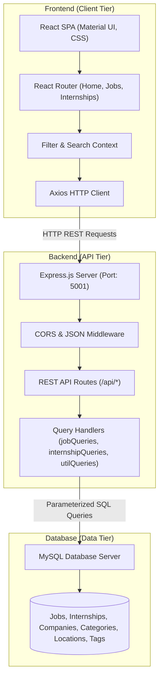

# Career Compass - Project Plan, Architecture & Structure

A comprehensive overview of the **Career Compass (Job & Internship Finding Portal)** project, detailing its architecture, file structure, component breakdown, database design, and setup guide.

---

## 1. System Architecture

The project is structured using a **3-Tier Client-Server Architecture**:



### Key Architectural Characteristics
- **Client (Frontend)**: Single-Page Application (SPA) built with React.js and Material-UI. It communicates with the backend asynchronously using Axios.
- **Server (Backend)**: Lightweight Express.js REST API with modularized SQL query logic and CORS-enabled endpoints.
- **Database (MySQL)**: Relational model storing jobs, internships, metadata (categories, tags, locations, companies), and linking tables for search and filtering.

---

## 2. Directory Structure

```plaintext
DBSMiniProject/
├── .gitignore                         # Git ignore configurations
├── README.md                          # Quick start instructions
├── PROJECT_PLAN_AND_ARCHITECTURE.md   # Detailed architecture & structure documentation
├── package-lock.json                  # Root lockfile
│
├── backend/                           # Node.js + Express API Backend
│   ├── .env                           # Database and server environment variables
│   ├── server.js                      # Express application entry point & route definitions
│   ├── jobQueries.js                  # SQL queries for job retrieval & filtering
│   ├── internshipQueries.js           # SQL queries for internship retrieval & filtering
│   ├── utilQueries.js                 # Shared utility queries (categories, locations, tags, global search)
│   ├── dataLoader.js                  # Data seeding / loading script
│   ├── envtest.js                     # Environment variable diagnostic script
│   └── package.json                   # Backend dependencies and scripts
│
├── frontend/                          # React.js Single Page Application
│   ├── package.json                   # Frontend dependencies and scripts
│   ├── public/                        # Static assets (HTML shell, icons, manifest)
│   └── src/
│       ├── index.js                   # Application root mount
│       ├── App.js                     # Top-level route setup
│       ├── App.css / index.css        # Global CSS styling
│       ├── pages/                     # Page-level components
│       │   ├── Home.js                # Landing page with hero banner & quick search
│       │   ├── Jobs.js                # Job listings page with multi-facet filter bar
│       │   ├── Jobs.css               # Styling for jobs page
│       │   ├── Internships.js         # Internship listings page
│       │   └── Internships.css        # Styling for internships page
│       ├── components/                # Reusable UI components
│       │   ├── Navbar.js              # Application navigation bar
│       │   ├── Background.js          # Dynamic background styling
│       │   ├── JobCard.js             # Card for displaying job/internship details
│       │   ├── JobCard.css            # Styles for listing cards
│       │   ├── Filters.js             # Master container for filter controls
│       │   ├── Filters.css            # Filter component styles
│       │   ├── JobFilters.js          # Job-specific filter controls (Salary, Experience)
│       │   ├── InternshipFilters.js   # Internship-specific filter controls (Stipend, Duration)
│       │   └── FilterComponents/      # Sub-components for filter options
│       └── context/                   # React Context providers for global state
│
└── extras/                            # Reference documents, mock data, and database scripts
    ├── jobs.txt / job_listings.txt              # Raw / seed job datasets
    ├── internships.txt / internship_listings.txt# Raw / seed internship datasets
    ├── sql_queries.txt                          # Schema definition and SQL query reference
    ├── project_diagram.html                     # Visual schema and relationship viewer
    └── project_report.txt                       # Project report and documentation
```

---

## 3. Core Component Breakdown

### 3.1 Frontend Components
| Component / File | Purpose |
| :--- | :--- |
| `App.js` | Configures client-side routing (`/`, `/jobs`, `/internships`). |
| `Home.js` | Landing view featuring quick search, featured categories, and platform introduction. |
| `Jobs.js` | Fetches and presents available jobs; integrates `JobFilters` and `JobCard`. |
| `Internships.js` | Fetches and presents available internships; integrates `InternshipFilters` and `JobCard`. |
| `JobCard.js` | Formatted card displaying company, title, compensation, location, type, and tags. |
| `JobFilters.js` / `InternshipFilters.js` | Dynamic filter bars allowing multi-criteria selection with real-time updates. |

### 3.2 Backend REST Endpoints
| HTTP Method | Route | Description |
| :--- | :--- | :--- |
| `GET` | `/api/jobs` | Retrieve filtered job listings (`location`, `category`, `minSalary`, `company`, `remote`, `tags`). |
| `GET` | `/api/jobs/:id` | Get details for a single job by ID. |
| `GET` | `/api/internships` | Retrieve filtered internship listings (`location`, `category`, `minStipend`, `duration`, `tags`). |
| `GET` | `/api/internships/:id` | Get details for a single internship by ID. |
| `GET` | `/api/job-filter-options` | Fetch available unique options for job filters. |
| `GET` | `/api/internship-filter-options` | Fetch available unique options for internship filters. |
| `GET` | `/api/search?q=...` | Keyword search across listing titles, descriptions, and companies. |
| `GET` | `/api/categories`, `/api/locations`, `/api/companies`, `/api/tags` | Metadata lookup routes. |

---

## 4. Technology Stack Summary

- **Frontend**: React 18, React Router v6, Material UI (`@mui/material`), Axios, Vanilla CSS.
- **Backend**: Node.js, Express.js, CORS, Dotenv.
- **Database**: MySQL (relational schema).

---

## 5. Development & Execution Plan

1. **Database Setup**:
   - Ensure MySQL is running locally.
   - Run the initialization scripts in `extras/sql_queries.txt` or execute `node backend/dataLoader.js`.
2. **Backend Startup**:
   - Create `backend/.env` with database credentials.
   - Run `cd backend && npm install && npm start` (Runs on `http://localhost:5001`).
3. **Frontend Startup**:
   - Run `cd frontend && npm install && npm start` (Runs on `http://localhost:3000`).
